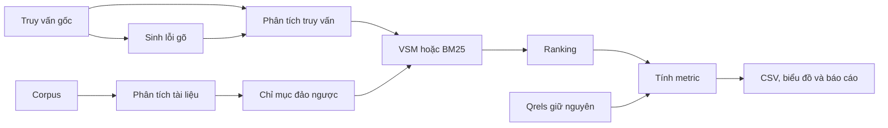

# Hướng dẫn đọc dự án truy xuất tài liệu

Đồ án trả lời một câu hỏi thực nghiệm. Khi truy vấn tiếng Anh có lỗi gõ, hệ thống tìm tài liệu bị suy giảm bao nhiêu và biểu diễn theo cụm ký tự giúp được đến đâu? Tập BEIR SciFact có 5.183 tài liệu, 809 truy vấn train và 300 truy vấn test. Mỗi truy vấn đi kèm **qrels**, tức các nhãn cho biết tài liệu nào được đánh giá là liên quan.

Tài liệu này giúp đọc mã và kết quả. [README](../README.md) có lệnh chạy, [báo cáo](../report/report.md) có công thức và phân tích đầy đủ, còn [PROGRESS.md](PROGRESS.md) ghi những gì đã hoàn tất và cách kiểm chứng.

## 1. Một truy vấn đi qua hệ thống thế nào?



1. **Chuẩn bị dữ liệu.** Loader đọc tài liệu, truy vấn và qrels theo ID, kiểm tra ID trùng, tài liệu tham chiếu và truy vấn train/test có giao nhau hay không.
2. **Phân tích và lập chỉ mục.** Title và abstract được ghép, chuẩn hóa và tách term. Chỉ mục đảo ngược lưu danh sách tài liệu chứa từng term. Ví dụ `cancer → {D1: 2, D7: 1}` nghĩa là D1 có hai lần xuất hiện và D7 có một lần.
3. **Truy xuất.** Khi nhận truy vấn, hệ thống áp dụng cùng analyzer đã dùng cho index, tìm posting list có liên quan, tính điểm bằng VSM hoặc BM25 rồi xếp hạng.
4. **Đánh giá.** Bộ đánh giá dùng qrels để đo mức độ tài liệu liên quan xuất hiện sớm trong ranking. Đối với truy vấn nhiễu, nó vẫn dùng qrels của truy vấn gốc.
5. **Tổng hợp.** Runner lưu ranking và metric của từng lượt. Script phân tích gom kết quả thành bảng, biểu đồ và ca truy vấn đại diện để viết báo cáo.

### Analyzer, term và hai mô hình

| Khái niệm | Ý nghĩa trong đồ án |
|---|---|
| Analyzer | Quy tắc chuyển văn bản thành term. Dự án chuẩn hóa Unicode NFKC, chuyển chữ thường và tách dãy chữ hoặc số ASCII. |
| Word unigram | Mỗi token là một term. `cancer` và `cancre` là hai term khác nhau. |
| Character n-gram | Lấy các đoạn 3, 4 hoặc 5 ký tự liên tiếp trong từng token. `cancer` và `cancre` chia sẻ `can`, `anc` và `canc`, nên vẫn có cơ hội khớp một phần. |
| TF, DF, CF | TF là số lần term xuất hiện trong một tài liệu, DF là số tài liệu chứa term, CF là tổng số lần trên cả corpus. |
| IDF | Tăng trọng số tương đối của term hiếm. VSM và BM25 dùng công thức IDF riêng. |
| OOV | Term nằm ngoài từ vựng của index, chẳng hạn một từ bị gõ sai mà corpus chưa từng có. Term ấy không góp điểm. |
| VSM | Biểu diễn truy vấn và tài liệu bằng TF-IDF, rồi dùng cosine để đo độ gần về hướng của hai vector. |
| BM25 | Tính điểm từ số lần term khớp, độ hiếm và độ dài tài liệu. Điểm tăng chậm dần khi một term lặp nhiều lần. |

M1 là VSM word, M2 là BM25 word, M3 là VSM char và M4 là BM25 char. VSM/BM25 là lựa chọn về **cách tính điểm**. Word/char là lựa chọn về **cách biểu diễn văn bản**.

## 2. Noise, seed và ranking

**Noise** trong dự án là lỗi gõ giả lập trên truy vấn. Với token đủ điều kiện, bộ sinh lỗi có thể xóa một ký tự (deletion), chèn ký tự (insertion), thay ký tự (substitution) hoặc đổi chỗ hai ký tự liền kề khác nhau (transposition). Chế độ **mixed** chọn giữa các phép khả thi. Corpus, nhãn liên quan và ID truy vấn gốc được giữ nguyên.

Ví dụ một truy vấn có 8 token đủ điều kiện và đặt tỷ lệ lỗi 20%. Bộ sinh dùng `floor(0.2 × 8 + 0.5) = 2` nên sửa 2 token, tức tỷ lệ thực tế là 25% cho truy vấn đó. Mỗi token được chọn tối đa một lần. JSONL lưu văn bản gốc, văn bản nhiễu, vị trí và loại lỗi. Nhờ đó có thể truy lại lý do một truy vấn tụt hạng.

**Seed** là số dùng để tái lập việc chọn ngẫu nhiên. Dự án kết hợp seed, ID truy vấn và điều kiện bằng SHA-256. Cùng các đầu vào đó sẽ cho cùng biến thể. Bốn cấu hình dùng chung biến thể trong từng điều kiện để chênh lệch điểm phản ánh cấu hình truy xuất thay vì việc mỗi mô hình gặp lỗi gõ khác nhau.

**Ranking** là danh sách tài liệu theo điểm giảm dần, gồm `doc_id`, `rank` và `score`. CLI có thể hiển thị top 5 hoặc top 10 để xem thử. Thực nghiệm lưu toàn bộ tài liệu có điểm dương hữu hạn để tính MAP.

| Chỉ số | Cách đọc |
|---|---|
| AP | Tổng precision tại các vị trí gặp tài liệu liên quan, chia cho tổng số tài liệu qrel dương của truy vấn. Một tài liệu liên quan ở hạng 1 đóng góp nhiều hơn ở hạng 10. |
| MAP | Trung bình AP qua các truy vấn được đánh giá. Đây là chỉ số chính của đồ án. |
| P@5, P@10 | Tỷ lệ tài liệu liên quan trong 5 hoặc 10 vị trí đầu, với mẫu số vẫn là 5 hoặc 10 nếu ranking ngắn. |
| Recall@10 | Phần tài liệu qrel dương tìm được trong 10 vị trí đầu. |
| nDCG@10 | Điểm ưu tiên tài liệu liên quan ở vị trí cao, chuẩn hóa theo thứ tự lý tưởng. |
| Tỷ lệ rỗng | Phần truy vấn được đánh giá có ranking rỗng. Truy vấn có qrel dương và ranking rỗng nhận AP bằng 0. |

## 3. Smoke test và thực nghiệm thật

| Loại kiểm tra | Câu hỏi trả lời | Ví dụ trong dự án |
|---|---|---|
| Unit test | Một phần nhỏ có làm đúng không? | Tính BM25 bằng tay trên vài tài liệu hoặc kiểm tra rằng cùng seed sinh đúng cùng lỗi. |
| Smoke test | Các phần có nối được với nhau và tạo đúng tệp không? | Chạy CLI trên 2 tài liệu, 1 truy vấn train, 2 truy vấn test. Kiểm tra dữ liệu → index → ranking → metric, kể cả truy vấn rỗng. |
| Thực nghiệm đầy đủ | Hiệu quả trên SciFact thật là bao nhiêu? | Chạy P14 trên 809 truy vấn train và 300 truy vấn test, lưu ranking và số đo thực tế. |

Smoke test ở P13 chạy đủ lịch 204 lượt test nhưng trên corpus rất nhỏ. Con số 204 ở đây kiểm tra **số điều kiện được nối đúng**. Kết quả dùng trong báo cáo lấy từ P14 trên SciFact thật.

| Nhóm | Làm gì | Số lượt |
|---|---|---:|
| E0 | Chọn tham số trên train sạch theo MAP. Sau đó khóa cấu hình. | 20 ứng viên |
| E1 | Đo baseline sạch cho M1–M4. | 4 |
| E2 | Mixed ở tỷ lệ mục tiêu 10%, 20%, 30% và 50%, với seed 42–46. | 80 |
| E3 | Thử riêng bốn loại lỗi ở tỷ lệ 20%, với seed 42–46. | 80 |
| E4 | Sửa đúng 1 hoặc 2 token, với seed 42–46. Dùng cùng tập đủ hai token cho cả hai mức và lấy baseline E1 theo đúng ID. | 40 |

E1–E4 có tổng cộng 204 lượt và 61.200 dòng metric theo truy vấn. **Baseline** là điểm sạch của chính cấu hình dùng để tính mức giảm. Ví dụ BM25 word có MAP sạch 0,6262 và còn khoảng 0,4827 ở mixed 50%, giảm khoảng 14,35 điểm phần trăm. Tại mức này, BM25 char đạt 0,5577 và giảm khoảng 3,99 điểm phần trăm so với baseline riêng. [Kết quả từng lượt](../results/p14-scifact-20261125/summary.csv) · [Bảng và phân tích](../results/p15-scifact-20261125/analysis.md)

## 4. Mỗi tệp dùng để làm gì?

### Mã trong `src/`

| Tệp | Vai trò |
|---|---|
| [data_loader.py](../src/data_loader.py) | Tải hoặc nhập ZIP BEIR, đọc corpus/queries/qrels và xác thực train/test. |
| [dataset_stats.py](../src/dataset_stats.py) | Xuất thống kê số tài liệu, số truy vấn, qrels và độ dài. |
| [preprocessing.py](../src/preprocessing.py) | Chuẩn hóa và sinh term word hoặc char. |
| [term_selection.py](../src/term_selection.py) | Tính DF/CF, lọc term theo ngưỡng và xuất danh sách từ vựng. |
| [inverted_index.py](../src/inverted_index.py) | Xây dựng, lưu và tải posting list cùng thống kê cần để tính điểm. |
| [tfidf.py](../src/tfidf.py), [bm25.py](../src/bm25.py) | Cài đặt hai công thức tính điểm. |
| [retrieval.py](../src/retrieval.py) | Gọi analyzer, chọn scorer và trả kết quả đã xếp hạng. |
| [batch_scoring.py](../src/batch_scoring.py) | Dùng mảng NumPy trên posting thưa để tăng tốc thực nghiệm. Đã đối chiếu ranking và điểm với scorer truy vấn. |
| [noise_generator.py](../src/noise_generator.py) | Sinh và lưu biến thể truy vấn có lỗi cùng thông tin tái lập. |
| [evaluation.py](../src/evaluation.py) | Tính metric theo truy vấn và theo lượt. |
| [experiments.py](../src/experiments.py) | Đọc giao thức E0–E4, tạo lịch chạy, chọn cấu hình theo MAP train và xác định tập E4. |
| [experiment_runner.py](../src/experiment_runner.py) | Thực thi lịch, dùng cấu hình đã khóa, lưu ranking, metric và manifest. |
| [results_analysis.py](../src/results_analysis.py) | Gộp số liệu qua seed, tính mức giảm và tạo bảng, hình. |
| [case_analysis.py](../src/case_analysis.py) | Trích ca giảm mạnh và ca cải thiện theo AP, đối chiếu term, OOV, top 5 và hạng tài liệu liên quan. |
| [cli.py](../src/cli.py), [`__init__.py`](../src/__init__.py) | CLI cung cấp các lệnh như `search` và `experiment`. Tệp khởi tạo đánh dấu `src` là package Python. |

### Các bài kiểm thử trong `tests/`

| Tệp | Kiểm tra |
|---|---|
| [test_dataset.py](../tests/test_dataset.py), [test_preprocessing.py](../tests/test_preprocessing.py) | Nhập ZIP, xác thực ID/split, tokenizer, từ vựng và ngưỡng lọc. |
| [test_retrieval.py](../tests/test_retrieval.py), [test_batch_scoring.py](../tests/test_batch_scoring.py) | Công thức điểm, lưu/tải index, tie-break và độ khớp của batch scorer. |
| [test_noise.py](../tests/test_noise.py), [test_evaluation.py](../tests/test_evaluation.py) | Bốn phép sửa, seed, ranking thiếu/rỗng, metric tính tay và đối chiếu với `ir-measures`. |
| [test_experiments.py](../tests/test_experiments.py), [test_integration.py](../tests/test_integration.py) | Ma trận E0–E4, dùng chung noise, baseline tập con E4 và smoke test CLI. |

### Cấu hình, dữ liệu và tài liệu

| Vị trí | Nội dung |
|---|---|
| [configs/default.yaml](../configs/default.yaml) | Lưới tham số E0, seed, tỷ lệ nhiễu và cutoff. |
| [requirements.txt](../requirements.txt), `.venv/` | Phiên bản dependency và môi trường Python cục bộ của dự án. |
| [download_scifact_hf.py](../download_scifact_hf.py) | Script tải bản Hugging Face đã dùng cho P14. |
| `data/raw/scifact/` | `corpus.jsonl`, `queries.jsonl`, qrels train/test và manifest nguồn. |
| `indexes/` | Index cục bộ có thể tái tạo để truy vấn thử. |
| `data/processed/p14-scifact-20261125/` | Kết quả đầy đủ, gồm E0, ranking, noise, per-query metrics và manifest. Dữ liệu lớn nằm trong nhóm thư mục Git bỏ qua. |
| [results/p14-scifact-20261125/summary.csv](../results/p14-scifact-20261125/summary.csv) | CSV nhỏ, mỗi dòng là một lượt đánh giá. |
| [results/p15-scifact-20261125/analysis.md](../results/p15-scifact-20261125/analysis.md) | Gói phân tích. `baseline.csv` là điểm sạch, `aggregate.csv` là trung bình và độ lệch chuẩn qua seed, `cases.csv/json` lưu ví dụ, `figures/` chứa biểu đồ. |
| [report/report.md](../report/report.md) | Báo cáo tiếng Việt, gồm phương pháp, công thức, kết quả, hạn chế và tài liệu tham khảo. |
| [PROJECT_SPEC.md](PROJECT_SPEC.md), [IMPLEMENTATION_PLAN.md](IMPLEMENTATION_PLAN.md), [AGENTS.md](AGENTS.md), [PROGRESS.md](PROGRESS.md) | Lần lượt ghi yêu cầu đồ án, kế hoạch triển khai, quy tắc làm việc và bằng chứng nghiệm thu. |

**Manifest** là hồ sơ của một artifact hoặc lượt chạy. Nó ghi cấu hình và checksum SHA-256 của dữ liệu, index, bộ nhiễu hoặc ranking. Checksum giúp đối chiếu các tệp có đúng là những tệp đã dùng lúc chạy. **JSONL** lưu mỗi bản ghi JSON trên một dòng; **CSV** lưu dữ liệu dạng bảng.

## 5. Các mốc đã làm và cách xem nhanh

- **P00–P04:** Chốt đặc tả, chuẩn bị Python và SciFact, viết analyzer và chọn term.
- **P05–P10:** Xây index, triển khai VSM/BM25 và CLI, sinh lỗi, dùng character n-gram để truy xuất.
- **P11–P13:** Viết bộ đánh giá, định nghĩa ma trận E0–E4 và chạy smoke test.
- **P14–P17:** Chạy SciFact thật, làm bảng và biểu đồ, viết báo cáo rồi kiểm tra hướng dẫn tái lập.
- **P18:** Rà soát và nghiệm thu cuối được theo dõi riêng trong tiến độ.

Để xem kết quả ngay, mở [phân tích P15](../results/p15-scifact-20261125/analysis.md). Để hiểu vì sao một truy vấn đổi hạng, chọn một ID trong [cases.csv](../results/p15-scifact-20261125/cases.csv) rồi đọc chi tiết tại [cases.json](../results/p15-scifact-20261125/cases.json). Để thử luồng từ đầu trên vài tài liệu, chạy lệnh sau ở thư mục gốc.

```powershell
.\.venv\Scripts\python.exe -m pytest -q tests/test_integration.py
```
