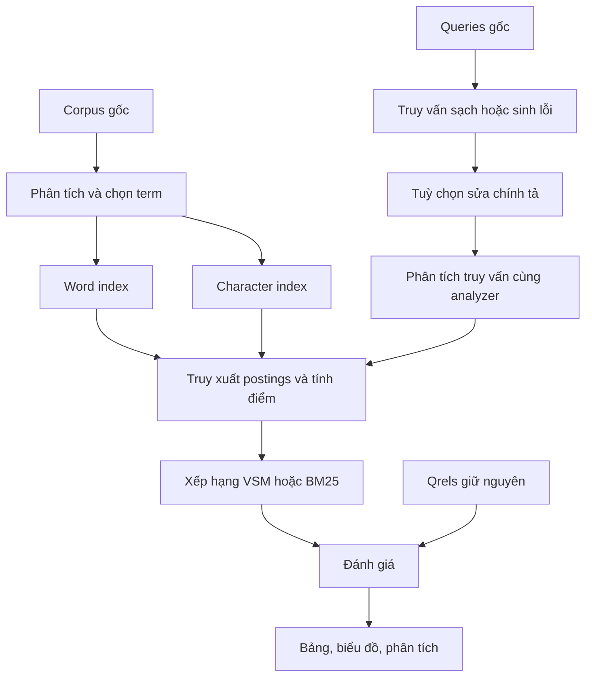

# ĐỒ ÁN 1 — TÌM KIẾM TÀI LIỆU
## Đặc tả yêu cầu, kế hoạch triển khai mã nguồn và hướng dẫn viết báo cáo

**Đề tài:** Nghiên cứu ảnh hưởng của lỗi chính tả trong câu truy vấn đến hiệu quả truy xuất tài liệu sử dụng mô hình không gian vector và BM25.

**English title:** Investigating the Impact of Query Spelling Errors on Document Retrieval Performance Using the Vector Space Model and BM25.

**Trạng thái:** Đặc tả triển khai đề xuất, chưa phải báo cáo kết quả thực nghiệm. Tài liệu dành cho thành viên nhóm hoặc lập trình viên/AI coding agent tiếp nhận công việc mà không cần đọc lịch sử trao đổi. Ngôn ngữ báo cáo mặc định: tiếng Việt; dữ liệu: tiếng Anh; mã nguồn: Python.

## 1. Căn cứ và phạm vi

### 1.1. Yêu cầu từ giảng viên

Nguồn chính: `Slide-13-01.pdf` (30 slide, Đề tài đồ án 1 – Tìm tài liệu) và `CS419-DeCuong.docx.pdf` (đề cương cập nhật 7/2024, TS. Nguyễn Trọng Chỉnh). Đề cương ghi mã CS416 ở mục 1.2, khác tên file CS419; xác nhận mã trước khi làm bìa.

- Đề cương mục 6, trang PDF 13: nhóm 2–3 sinh viên; áp dụng, triển khai, đánh giá và so sánh hai mô hình truy xuất trên một tập ngữ liệu thử nghiệm có sẵn; thuyết trình.
- Mục 4.1, trang PDF 8: buổi 13–14 dành cho thuyết trình, báo cáo tiến độ, so sánh hai mô hình và trả lời câu hỏi.
- Mục 5.1, trang PDF 10: A1 quá trình/thuyết trình 25%, A3 báo cáo đồ án 25%, A4 thi cuối kỳ 50%, không có điểm giữa kỳ.
- Rubric A3, trang PDF 11–12: trình bày đúng khái niệm và phương pháp (CLO1), kết quả đánh giá đúng và giải thích được (CLO2), mô hình truy xuất chính xác và giải thích được (CLO3). Rubric cũng có CLO4 về phân lớp; cần xác nhận cách áp dụng khi chỉ chọn đồ án 1.

| Phần trong slide | Sản phẩm cần có | Vị trí báo cáo đề xuất |
|---|---|---|
| 1. Bài toán tìm tài liệu (3–7) | Phát biểu bài toán, miền tri thức, tập tài liệu | Chương 1 |
| 2. Chọn term (8–12) | Loại term và lý do, phương pháp, thuật toán, danh sách term và tỷ lệ giữ lại | Chương 3 |
| 3. Mô hình truy xuất (13–16) | Biểu diễn tài liệu/truy vấn, độ đo tương đồng hoặc liên quan | Chương 4 |
| 4. Công thức xếp hạng (17–21) | Công thức cơ sở, trọng số term, công thức xếp hạng | Chương 4 |
| 5. Lập chỉ mục và xử lý truy vấn (22–25) | Cấu trúc chỉ mục, thuật toán lập chỉ mục, tính/lưu số liệu, truy xuất và tính điểm | Chương 5 |
| 6. Thử nghiệm và đánh giá (26–30) | Mô tả ngữ liệu, bảng độ đo, phân tích trường hợp cao/thấp | Chương 6–7 |

Slide 23–24 đề cập vị trí term, nén chỉ mục, truy vấn Boolean và cụm term liên tiếp; các nội dung này có thể mô tả hoặc mở rộng theo phạm vi đã chọn, không mặc định phải hiện thực tất cả. Slide 29 phân biệt P/R/F1 cho không xếp hạng, P@k/MAP cho có xếp hạng, nDCG khi có mức độ liên quan.

### 1.2. Quyết định triển khai của nhóm (đề xuất, không phải quy định giảng viên)

| Thành phần | Quyết định |
|---|---|
| Đồ án | Chỉ chọn đồ án 1; không triển khai phân lớp văn bản |
| Dataset | BEIR SciFact, tiếng Anh |
| Mô hình | Vector Space Model (TF-IDF + cosine), Okapi BM25 |
| Term | Word unigram; character n-gram (3–5); word bigram là mở rộng |
| Chỉ mục | Tự hiện thực inverted index, dùng chung cho hai mô hình theo mỗi kiểu term |
| Nghiên cứu | Lỗi đánh máy trong truy vấn, corpus và qrels giữ nguyên |
| Lỗi | Deletion, insertion, substitution, transposition |
| Độ đo chính | MAP trên ranking đầy đủ các tài liệu có điểm dương |
| Độ đo bổ sung | P@5, P@10, Recall@10, nDCG@10, tỷ lệ truy vấn không có kết quả |
| Khắc phục | Character n-gram là phần chính; sửa chính tả theo từ điển là mở rộng ưu tiên |
| Nền tảng | Python, CPU, CLI; không bắt buộc web/GPU/deep learning |

Không mặc định cần Web Crawler, BERT, LLM, mô hình phân lớp, cơ sở dữ liệu quan hệ, hoặc toàn bộ mô hình đã học. Không có ngưỡng MAP tối thiểu được ghi trong tài liệu. Cần giảng viên xác nhận tên đề tài/phạm vi nếu có quy định lớp riêng.

## 2. Mô tả bài toán và nghiên cứu

Cho tập tài liệu $D=\{d_1,\ldots,d_N\}$, truy vấn $q$ và tập tài liệu được đánh giá liên quan $R_q$. Hệ thống nhận truy vấn và trả danh sách tài liệu theo điểm liên quan giảm dần. Từ mỗi truy vấn gốc tạo biến thể $q'$ chứa lỗi chính tả nhưng cố gắng giữ nguyên ý định; dùng cùng $R_q$ để đánh giá. Chỉ nghiên cứu retrieval, không xác minh nhận định khoa học đúng/sai.

| RQ | Câu hỏi | Thí nghiệm |
|---|---|---|
| RQ1 | Lỗi làm thay đổi chất lượng truy xuất ra sao? | E1–E2 |
| RQ2 | Loại lỗi nào gây suy giảm nhiều nhất? | E3 |
| RQ3 | Mức độ lỗi ảnh hưởng thế nào? | E2, E4 |
| RQ4 | VSM hay BM25 chịu lỗi tốt hơn? | E1–E3 |
| RQ5 | Character n-gram có cải thiện độ bền so với word term? | E1–E4 |
| RQ6 (mở rộng) | Sửa chính tả có khôi phục hiệu quả không? | E5 |

Giả thuyết: lỗi làm giảm trùng khớp từ; character n-gram giữ lại một phần trùng khớp; BM25 và VSM có thể suy giảm khác nhau; sửa lỗi có thể hữu ích nhưng cũng có thể sửa nhầm thuật ngữ khoa học. Không coi giả thuyết là kết luận. Không tạo hoặc điền số liệu giả.

## 3. Dataset và quản lý dữ liệu

Nguồn tải phiên bản BEIR: https://public.ukp.informatik.tu-darmstadt.de/thakur/BEIR/datasets/scifact.zip

Nguồn tham khảo: https://huggingface.co/datasets/BeIR/scifact ; https://github.com/beir-cellar/beir ; https://github.com/allenai/scifact .

SciFact chứa tiêu đề và tóm tắt bài báo khoa học; truy vấn là nhận định khoa học, không nhất thiết là câu hỏi tìm kiếm tự nhiên. Quy mô dự kiến theo benchmark: 5.183 tài liệu, 300 truy vấn test, khoảng 1,1 tài liệu được đánh giá liên quan/truy vấn. Các con số phải được kiểm tra lại bằng script khi tải. Nhãn BEIR dự kiến nhị phân; kiểm tra tập giá trị score thực tế. Dữ liệu chưa được tải hoặc chạy trong tài liệu đặc tả này.

```text
data/raw/scifact/
  corpus.jsonl       # _id, title, text, metadata (nếu có)
  queries.jsonl      # _id, text, metadata (nếu có)
  qrels/train.tsv    # query-id, corpus-id, score
  qrels/test.tsv
```

### 3.1. Tải, đọc và xác thực

- Viết script tải/giải nén idempotent; không ghi đè dữ liệu gốc; ghi URL, ngày tải, SHA-256, phiên bản và thông tin giấy phép kiểm tra từ nguồn.
- Đọc JSONL UTF-8 và TSV theo header, giữ ID dạng chuỗi. Kiểm tra trùng ID, dữ liệu rỗng, qrels tham chiếu ID tồn tại, score hợp lệ; báo lỗi có thông tin thay vì bỏ qua âm thầm.
- Ghép `title + " " + text` thành nội dung lập chỉ mục; không dùng nhãn hoặc truy vấn để tính IDF. Không bỏ tài liệu vì không có qrels.
- Lấy truy vấn của từng split theo ID trong qrels tương ứng. Kiểm tra train/test không giao ID. Dùng train làm tập phát triển để lựa chọn tham số; test chỉ đánh giá cấu hình đã chốt. Nếu cần validation riêng, tách train theo query ID với seed cố định. Không coi corpus dùng chung là rò rỉ, nhưng không dùng qrels test để lựa chọn tham số.
- Lưu `dataset_manifest.json`, `dataset_stats.json` và bảng CSV thống kê.

### 3.2. Thống kê cần đưa vào báo cáo (slide 27)

Ngôn ngữ, lĩnh vực, nguồn, số tài liệu, số truy vấn theo split, số qrels và số qrels dương, phân bố số tài liệu liên quan/truy vấn, min/median/mean/max độ dài tài liệu và truy vấn (định nghĩa tokenizer thống nhất), phân bố score, số bản ghi lỗi/rỗng, ví dụ thực lấy từ dữ liệu và hạn chế của benchmark. Tách thống kê số từ thô khỏi số term sau lọc.

## 4. Kiến trúc và pipeline



Lập chỉ mục offline một lần cho mỗi cấu hình analyzer; tải lại index khi tìm kiếm. Query processing online không duyệt toàn bộ corpus để tìm từ, không lập lại index. Kết quả mỗi truy vấn: doc ID, rank, score; demo có tiêu đề và snippet. Mọi mô hình sử dụng cùng tập tài liệu và biến thể truy vấn khi so sánh.

## 5. Phân tích tài liệu và chọn term

### 5.1. Analyzer mặc định

1. Chuẩn hóa Unicode NFKC, lowercase; tokenizer regex chữ/số tiếng Anh (ví dụ `[a-z0-9]+`), giữ số vì có thể quan trọng trong khoa học. Công bố quy tắc dấu gạch nối, dấu câu, ký tự ngoài ASCII; không âm thầm đổi giữa các mô hình.
2. Word: unigram từ tokenizer. Thử stopword removal trên train bằng danh sách cố định (lưu phiên bản/danh sách; cân nhắc giữ `no`, `not`); stemming Snowball là thử nghiệm mở rộng, không mặc định bật vì có thể làm nhiễu tác động lỗi. Nếu bigram được thử, tạo từ token liền kề và ghi cách xử lý stopword.
3. Character: sinh n-gram trong từng token, không nối qua ranh giới từ, n=3,4,5; giữ tần suất lặp. Với token ngắn hơn 3, dùng token có tiền tố riêng như `short:ab` hoặc bỏ theo quy tắc đã công bố (mặc định dùng tiền tố). Không stemming cho char. Có thể thử n=3 hoặc 3–5 trên train.
4. Tính DF trên corpus, lọc theo `min_df` (mặc định 1; thử 2, 3 trên train), tùy chọn `max_df_ratio` (mặc định 1.0). Analyzer truy vấn dùng đúng vocabulary và quy tắc của index, bỏ term OOV khi scoring nhưng thống kê riêng.
5. Khi so sánh word/char chính, giữ cùng bước normalization/tokenization và chính sách stopword; mặc định không loại stopword để cô lập ảnh hưởng biểu diễn. Nếu chọn cấu hình khác dựa trên train, ghi rõ đây là so sánh cấu hình tối ưu thay vì chỉ thay một biến.

### 5.2. Sản phẩm và thuật toán

- `analyze(text, config) -> list[str]`; `fit_vocabulary(corpus, config) -> vocabulary, stats`; hai lượt qua corpus hoặc cache term counts.
- Xuất danh sách term (CSV/TSV UTF-8: term, df, cf, selected, reason) cho mỗi analyzer, có cả danh sách giữ lại riêng; lưu số distinct term trước/sau lọc và tổng occurrences.
- Tỷ lệ giữ lại = số distinct term được giữ / số distinct term ứng viên cùng kiểu analyzer × 100%; không lấy vocabulary char chia vocabulary word; nếu mẫu số 0 ghi N/A. Báo cáo thêm tỷ lệ occurrence giữ lại và số OOV truy vấn nếu hữu ích.
- Ví dụ `cancer` và `cancre` không khớp unigram nhưng có chung `can`, `anc` ở trigram. Minh họa không phải kết quả dataset.
- Thống kê chi phí: kích thước vocabulary, số postings, dung lượng index, thời gian lập chỉ mục; giải thích đánh đổi chất lượng–chi phí.

## 6. Lập chỉ mục đảo ngược

### 6.1. Cấu trúc dữ liệu

```python
postings = {"cancer": {"D1": 2, "D3": 1}}
df = {"cancer": 2}
cf = {"cancer": 3}
doc_lengths = {"D1": 10, "D3": 8}
doc_norms = {...}  # norm TF-IDF của toàn vector tài liệu
```

Ví dụ giả định. Lưu `N`, `avgdl`, `df`, `cf`, `doc_lengths`, `doc_norms`, vocabulary, metadata ID/title, analyzer config, checksum corpus và schema version. Độ dài tài liệu là số occurrence term được giữ lại trong index tương ứng; tính cả tài liệu độ dài 0 khi lấy avgdl. Không dùng độ dài word cho BM25 char. Có thể dùng dict hoặc cấu trúc sparse/arrays; không dùng ma trận dense toàn corpus × vocabulary.

### 6.2. Thuật toán

```text
Pass 1: phân tích mỗi tài liệu, đếm term, cộng DF một lần/term/document.
Chọn vocabulary theo ngưỡng đã định.
Pass 2: lọc term, tạo posting (doc_id, tf), tính cf, doc_length.
Tính N, avgdl và IDF của từng mô hình.
Tính norm TF-IDF trên tất cả term của từng tài liệu.
Lưu index và manifest; kiểm tra load lại cho kết quả giống nhau.
```

Độ phức tạp gần O(T) với T là tổng occurrence term (chưa tính sắp xếp/IO); bộ nhớ phụ thuộc số posting và vocabulary. Nêu chi phí thực tế; vị trí term và nén postings là phần mở rộng, không tuyên bố hỗ trợ nếu chưa làm.

## 7. Hai mô hình và công thức xếp hạng

Ký hiệu: $f(t,d)$ là TF, $df(t)$ là DF, $N$ tổng số tài liệu, $|d|$ độ dài sau analyzer, $avgdl$ trung bình độ dài. Cả hai mô hình lấy ứng viên là hợp các posting lists của term truy vấn có trong index.

### 7.1. Mô hình không gian vector (VSM)

Dùng log-TF và IDF có smoothing (biến thể triển khai đề xuất, ghi đúng trong báo cáo):

$$TF(t,d)=\begin{cases}1+\ln f(t,d)&f(t,d)>0\\0&\text{otherwise}\end{cases}$$
$$IDF_{VSM}(t)=1+\ln\frac{N+1}{df(t)+1}$$
$$w(t,d)=TF(t,d)\,IDF_{VSM}(t)$$
$$Score(d,q)=\frac{\sum_t w(t,d)w(t,q)}{\sqrt{\sum_t w(t,d)^2}\sqrt{\sum_t w(t,q)^2}}$$

Truy vấn dùng cùng IDF corpus và log-TF; norm truy vấn chỉ tính term trong vocabulary. Norm tài liệu phải tính trên toàn bộ vector, không chỉ term truy vấn. Duyệt postings để cộng tử số, chia norm đã lưu. Nếu query norm hoặc doc norm bằng 0, không trả điểm dương; không chia 0.

### 7.2. Okapi BM25

$$IDF_{BM25}(t)=\ln\left(1+\frac{N-df(t)+0.5}{df(t)+0.5}\right)$$
$$Score(d,q)=\sum_{t\in unique(q)\cap V}IDF_{BM25}(t)\frac{f(t,d)(k_1+1)}{f(t,d)+k_1(1-b+b|d|/avgdl)}$$

Mặc định $k_1=1.2$, $b=0.75$; mỗi term truy vấn phân biệt góp một lần, không dùng hệ số query TF ở biến thể này. Thử $k_1\in\{0.8,1.2,1.5,2.0\}$, $b\in\{0,0.5,0.75,1\}$ trên train/dev nếu có thời gian. Nếu avgdl=0 trả rỗng có cảnh báo. Giải thích TF saturation, chuẩn hóa độ dài, IDF khác VSM; không coi BM25 là mô hình cần huấn luyện nhãn.

### 7.3. Quy ước ranking

- Điểm giảm dần; tie-break doc ID theo thứ tự chuỗi tăng dần. Chỉ trả tài liệu có score dương hữu hạn; truy vấn không có term hợp lệ trả `[]`. Không chèn tài liệu 0 điểm để cải thiện metric.
- `search(query, model, index, top_k=None) -> list[Hit]`. Khi đánh giá MAP dùng toàn bộ ứng viên dương; CLI mặc định top 10. Nếu giới hạn rank phải gọi đúng MAP@K và công bố K.
- Có thể dùng scikit-learn hoặc rank_bm25 để kiểm chứng biến thể tương đương, nhưng triển khai chính tự tính điểm và truy xuất posting; không thay phần thuật toán bằng lời gọi API hộp đen. Nếu khác biến thể IDF, không kỳ vọng điểm trùng tuyệt đối.

## 8. Sinh lỗi chính tả

### 8.1. Loại lỗi

| Loại | Ví dụ (minh họa) | Quy tắc |
|---|---|---|
| Deletion | learning → lerning | Xóa một ký tự |
| Insertion | learning → learnning | Chèn một ký tự a–z |
| Substitution | learning → leurning | Thay một ký tự bằng ký tự khác |
| Transposition | learning → leanring | Đổi chỗ hai ký tự liền kề khác nhau |
| Mixed | nhiều loại trong một tập | Chọn đều giữa bốn loại khả thi |

Sinh lỗi trên text gốc trước analyzer; chỉ chọn token chữ ASCII dài tối thiểu 3, không sửa số, dấu câu, ID; giữ cấu trúc khoảng trắng và viết hoa nếu có thể. Không chọn token không thể thực hiện phép sửa; đảm bảo mỗi phép thực sự thay đổi từ. Mỗi token được chọn chịu đúng một phép sửa trong thí nghiệm chính; chọn vị trí token không hoàn lại. Lỗi có thể vô tình tạo từ hợp lệ hoặc đổi nghĩa; lưu cờ kiểm tra, khảo sát thủ công mẫu, không giả định luôn giữ nghĩa.

### 8.2. Mức độ lỗi và tính tái lập

- Tỷ lệ r trên số token đủ điều kiện m, chọn `k = floor(r*m + 0.5)` với r dạng 0–1. Không ép tối thiểu 1 ở thí nghiệm tỷ lệ; query ngắn có thể không đổi. Báo cáo tỷ lệ thực tế, số query thay đổi, phân bố k. Với m=0 giữ nguyên và ghi trạng thái.
- Mức r: 0%, 10%, 20%, 30%, 50%. Bổ sung thí nghiệm cố định 1 hoặc 2 token bị lỗi (nếu thiếu token, ghi không đủ điều kiện và báo số lượng; so sánh trên tập query đủ điều kiện cố định).
- Seed: 42, 43, 44, 45, 46. Dùng RNG ổn định theo seed + query ID + điều kiện (hash SHA-256 thay vì hash Python thay đổi theo process). Duyệt query ID có thứ tự; dùng cùng noisy queries cho mọi mô hình, không sinh lại trong scorer.
- Giữ query ID gốc để join qrels; định danh biến thể riêng bằng split, loại lỗi, tỷ lệ hoặc k và seed. Không ghi đè truy vấn gốc.

Schema `noisy_queries.jsonl`: `qid`, `variant_id`, `split`, `original`, `noisy`, `noise_type`, `target_rate`, `eligible_count`, `edited_count`, `actual_rate`, `seed`, `edits` (token index, original token, modified token, operation, character position), `status`. Lưu manifest và kiểm tra tái lập bằng checksum.

## 9. Phương pháp khắc phục

### 9.1. Chính: Character n-gram

So sánh M1/M2 với M3/M4 ở cùng ranking model và noise. Đây là thay đổi biểu diễn chứ không phải sửa văn bản. Đánh giá cả hiệu quả tuyệt đối trên clean/noisy và mức giảm so với clean của chính cấu hình, tránh kết luận chịu lỗi tốt chỉ vì baseline thấp.

### 9.2. Mở rộng ưu tiên: Query spelling correction

Dùng vocabulary từ corpus (từ gốc trước stemming) và corpus frequency. Chỉ thử sửa từ OOV chữ cái dài >=3; không sửa từ đúng có trong từ điển; bỏ qua số và từ viết tắt theo quy tắc rõ ràng. Tạo ứng viên khoảng cách Damerau-Levenshtein <=1 (hoặc <=2 nếu dev cho thấy hữu ích); ưu tiên khoảng cách nhỏ, rồi tần suất corpus cao, tie-break từ theo alphabet. Có thể dùng BK-tree hoặc thư viện khoảng cách có kiểm thử transposition. Nếu không có ứng viên phù hợp, giữ nguyên. Không dùng truy vấn sạch, qrels test, hoặc vị trí lỗi thật từ metadata để sửa trong pipeline thực tế.

So sánh Word VSM/BM25 trước/sau correction trên cùng truy vấn; thêm clean + correction để đo overcorrection. Lưu số token sửa, tỷ lệ khôi phục chính xác token bị lỗi (dùng metadata chỉ khi đánh giá), sửa nhầm token sạch, ví dụ thuật ngữ khoa học. Nếu không triển khai E5, ghi RQ6 ngoài phạm vi và không đưa kết luận về sửa lỗi.

## 10. Thiết kế thực nghiệm

| ID | Mô hình | Term |
|---|---|---|
| M1 | VSM | Word |
| M2 | BM25 | Word |
| M3 | VSM | Character |
| M4 | BM25 | Character |

| ID | Điều kiện | Cấu hình | Mục tiêu |
|---|---|---|---|
| E0 | Train/dev, sạch (và noisy dev nếu lựa chọn robustness) | M1–M4 | Chọn analyzer/tham số; ghi tiêu chí trước khi chạy |
| E1 | Test sạch | M1–M4 | Baseline, 1 lần/cấu hình |
| E2 | Mixed noise, 10/20/30/50%, 5 seed | M1–M4 | Đường cong suy giảm (80 run) |
| E3 | 4 loại lỗi riêng, 20%, 5 seed | M1–M4 | So sánh loại lỗi (80 run) |
| E4 | Mixed noise, cố định 1/2 token, 5 seed | M1–M4 | Kiểm tra ảnh hưởng làm tròn (40 run) |
| E5 | Sửa chính tả clean và các mức mixed E2 | M1/M2 | Mở rộng (42 run mới, đối chiếu E1/E2) |

Tổng thiết kế chính E1–E4: 204 lượt đánh giá toàn tập (không phải 204 lần lập chỉ mục); E0 tùy số cấu hình, E5 tùy chọn. E4 sử dụng cùng tập query có ít nhất 2 token hợp lệ cho cả k=1,2 và baseline riêng tương ứng; không so trực tiếp baseline toàn tập với tập con. Số run là kế hoạch, chưa thực hiện. Có thể cache ranking và chạy batch để giảm thời gian.

**Kiểm soát:** chốt cấu hình trên train/dev; không chọn tham số theo test; ghi rõ số lần tune, tham số và tiêu chí (mặc định MAP clean dev; nếu tối ưu robustness phải xác định mục tiêu trước). Dùng cùng corpus, qrels, analyzer theo cấu hình, noise files, cutoff và tie-break. Báo cáo trung bình và độ lệch chuẩn giữa 5 seed (không coi 5 seed là 5 tập query độc lập). Có thể bootstrap theo query ID để lấy CI 95% cho chênh lệch paired MAP, hoặc kiểm định paired nếu cần; không tuyên bố ý nghĩa thống kê khi chưa kiểm định.

## 11. Đánh giá

Với relevance nhị phân `score > 0`, gọi $rel_q(i)$ là chỉ báo liên quan tại rank i, $R_q$ là tập tài liệu có qrel dương. Tài liệu không được đánh giá được coi là không liên quan trong phép tính benchmark (không khẳng định thực tế không liên quan).

$$P@k(q)=\frac{\sum_{i=1}^k rel_q(i)}{k},\quad Recall@k(q)=\frac{\sum_{i=1}^k rel_q(i)}{|R_q|}$$
$$AP(q)=\frac{1}{|R_q|}\sum_{i=1}^{L}P@i(q)rel_q(i),\qquad MAP=\frac{1}{|Q|}\sum_{q\in Q}AP(q)$$
$$DCG@k=\sum_{i=1}^k\frac{2^{rel_q(i)}-1}{\log_2(i+1)},\quad nDCG@k=DCG@k/IDCG@k$$

IDCG sắp xếp relevance lý tưởng từ qrels. Với danh sách ngắn hơn k, rank thiếu có relevance 0, P@k vẫn chia k. Query không có kết quả nhưng có qrel dương nhận 0 cho các metric. Nếu query không có qrel dương, loại khỏi tập đánh giá theo chính sách công bố và ghi số lượng, không loại query vì lỗi làm mất kết quả. Không loại qrel dương bị bỏ lỡ khỏi mẫu số AP. Nếu tính P/R/F1 không xếp hạng, định nghĩa tập trả về (ví dụ score dương hoặc top-k) và báo cáo rõ; F1=2PR/(P+R), 0 nếu mẫu số 0. SciFact nhị phân vẫn tính được nDCG nhưng không nghiên cứu được graded relevance nhiều mức.

Độ suy giảm tuyệt đối `drop = MAP_clean - MAP_noisy`; tương đối `100*drop/MAP_clean` (N/A nếu baseline 0); báo cáo điểm phần trăm nếu nhân 100. Với sửa lỗi, `gain = MAP_corrected - MAP_noisy`. Không ép drop dương. Đo thêm latency truy vấn (median/p95, không gồm index loading), thời gian lập chỉ mục, dung lượng index và tỷ lệ truy vấn rỗng; ghi cấu hình máy, Python, số thread, quy tắc đo.

Kiểm chứng metric bằng ví dụ: relevant={D1,D3}, ranking=[D1,D2,D3] => AP=(1+2/3)/2=0.833333; P@5=2/5; Recall@5=1. Ranking=[D2,D4,D1,D5,D3] => AP=(1/3+2/5)/2=0.366667. Đối chiếu thêm với `ir_measures` hoặc `pytrec_eval` theo cùng quy ước/cutoff.

## 12. Cấu trúc repository và trách nhiệm module

```text
project/
  README.md
  requirements.txt
  .gitignore
  configs/default.yaml
  data/raw/                  # không commit dữ liệu lớn
  data/processed/            # manifest, noise files
  indexes/                   # cache, metadata
  src/
    __init__.py
    cli.py                   # điều phối lệnh
    data_loader.py           # download, validate, read splits
    dataset_stats.py         # thống kê
    preprocessing.py         # analyzer word/char
    term_selection.py        # DF, lọc, vocabulary export
    inverted_index.py        # build/save/load, thống kê
    retrieval.py             # giao diện search, rank
    tfidf.py                 # scoring VSM
    bm25.py                  # scoring BM25
    noise_generator.py       # lỗi, seed, metadata
    spell_correction.py      # mở rộng
    evaluation.py            # per-query metrics
    experiments.py           # tune/batch, aggregate
    visualization.py         # charts, case studies
  tests/
    test_preprocessing.py
    test_index.py
    test_retrieval.py
    test_noise.py
    test_evaluation.py
    test_integration.py
  results/
    manifests/ vocabularies/ runs/ metrics/ figures/ cases/
  report/
    report.md                # hoặc định dạng nộp theo yêu cầu lớp
    references.bib
  slides/
```

Giao diện tối thiểu: `load_dataset(path, split)`, `analyze(text, config)`, `build_index(corpus, config)`, `save_index/load_index`, `score_tfidf/score_bm25`, `search`, `generate_noise`, `evaluate(rankings, qrels, k)`, `run_experiments(config)`. Dùng type hints, docstrings, pathlib, logging; config tập trung; tránh hardcode đường dẫn tuyệt đối. Thư viện đề xuất: Python chuẩn, numpy, pandas, matplotlib, PyYAML, pytest; nltk tùy chọn; ir_measures để đối chiếu. Pin phiên bản đã chạy thực tế trong requirements. Không bắt buộc GPU hay framework web.

### 12.1. CLI cần hiện thực (hợp đồng giao diện đề xuất, chưa phải lệnh chạy được ngay)

```bash
python -m venv .venv
# kích hoạt .venv theo hệ điều hành
pip install -r requirements.txt
python -m src.cli download --dataset scifact
python -m src.cli stats --config configs/default.yaml
python -m src.cli build-index --config configs/default.yaml --analyzer word
python -m src.cli build-index --config configs/default.yaml --analyzer char
python -m src.cli search --model bm25 --analyzer word --query "vitamin reduces cancre risk" --top-k 10
python -m src.cli tune --split train --config configs/default.yaml
python -m src.cli generate-noise --split test --config configs/default.yaml
python -m src.cli experiment --split test --config configs/default.yaml
python -m src.cli analyze-results --config configs/default.yaml
pytest -q
```

README phải hướng dẫn chạy từ môi trường sạch, giải thích flags, output, cấu hình, lỗi thường gặp và cách tái tạo toàn bộ bảng/biểu đồ. Lệnh tune lưu cấu hình đã chốt; experiment đọc cấu hình đó và không tự tune trên test. Hỗ trợ chạy lại từng nhóm thí nghiệm và bỏ qua run đã hoàn tất đúng checksum/config.

### 12.2. Output cần lưu

| File | Nội dung tối thiểu |
|---|---|
| `dataset_stats.json` | Thống kê mục 3 |
| `vocabulary_word.tsv`, `vocabulary_char.tsv` | Term, DF, CF, selected |
| `index_stats.csv` | vocab size, postings, avgdl, bytes, build time |
| `selected_config.yaml`, `tuning.csv` | Tham số, score dev, số cấu hình |
| `noisy_queries.jsonl` | Biến thể và edit metadata |
| `runs/<run_id>.jsonl` | qid, variant_id, danh sách doc_id/rank/score; kể cả query rỗng |
| `metrics/per_query.csv` | run_id, qid, AP, P@5, P@10, Recall@10, nDCG@10, latency, OOV |
| `metrics/summary.csv` | model, analyzer, noise_type, rate/k, seed, n_queries, MAP và metric trung bình |
| `metrics/aggregate.csv` | mean/std theo seed, baseline, drop, gain nếu có |
| `manifests/<run_id>.json` | config, index hash, data/noise hash, seed, phiên bản, cutoff, môi trường |
| `figures/*.png` | Biểu đồ từ CSV thật |
| `cases/*.md` hoặc CSV | Phân tích truy vấn đại diện |

## 13. Kiểm thử và tiêu chí kỹ thuật

| Kiểm thử | Kỳ vọng |
|---|---|
| Tokenizer/char n-gram | Kết quả đúng với ví dụ nhỏ, nhất quán document/query |
| Vocabulary | DF không đếm lặp trong một doc, tỷ lệ giữ lại đúng |
| Index | Posting TF/DF/CF và doc length khớp tính tay; load/save giữ kết quả |
| VSM | Norm toàn vector, cosine trong [0,1] sai số nhỏ; khớp tính tay |
| BM25 | Khớp tính tay với công thức đã chọn; không chia 0 |
| Ranking | Không trùng doc ID, tie-break ổn định, điểm giảm dần |
| Empty/OOV | Trả rỗng, metric 0 khi có qrel dương |
| Noise | Seed giống nhau cho kết quả giống nhau, r=0 không thay đổi, đúng k, lỗi thực sự đổi ký tự |
| Qrels | Giữ nguyên ID và score, phát hiện ID thiếu, split không giao |
| Metrics | AP/P@k/Recall/nDCG đúng với fixture tính tay và công cụ tham chiếu |
| Correction | Không dùng original/qrels; từ OOV có thể sửa, không ứng viên giữ nguyên |
| End-to-end | Corpus nhỏ → index → search → noise → evaluate → xuất bảng; chạy được trên SciFact |

Không báo cáo test pass nếu chưa chạy. Lưu log pytest, smoke test và lỗi đã biết. Đo hiệu năng sau khi chức năng đúng; không hy sinh tính chính xác metric vì tốc độ.

## 14. Hướng dẫn viết báo cáo

Cấu trúc dưới đây là đề xuất bám sát slide, không phải mẫu bắt buộc. Báo cáo dùng số liệu từ output thật; thuật toán, công thức và cấu hình phải đồng nhất với code.

| Chương | Nội dung bắt buộc phải trình bày | Minh chứng |
|---|---|---|
| 1. Giới thiệu | Động cơ lỗi chính tả, phát biểu bài toán, mục tiêu, phạm vi, RQ, đóng góp | Ví dụ truy vấn sạch/lỗi, sơ đồ bài toán |
| 2. Cơ sở lý thuyết và nghiên cứu liên quan | IR, term, inverted index, lỗi đánh máy, robustness, các nghiên cứu liên quan; phân biệt retrieval/verification | Trích dẫn đúng nguồn, không bịa bài báo |
| 3. Phân tích và chọn term | Loại term, lý do, thuật toán phân tích/lọc, word/char, danh sách term, tỷ lệ giữ lại | Bảng vocabulary, pseudocode, ví dụ n-gram |
| 4. Mô hình và công thức xếp hạng | Biểu diễn doc/query, VSM, cosine, BM25, trọng số, tham số, so sánh lý thuyết | Công thức, giải nghĩa ký hiệu, ví dụ tính tay |
| 5. Thiết kế và hiện thực hệ thống | Kiến trúc, cấu trúc index, lập/lưu chỉ mục, query processing, noise/correction, module, kiểm thử | Mermaid/UML phù hợp, pseudocode, bảng schema, log test |
| 6. Thiết kế thực nghiệm | Nguồn dataset, thống kê, split, biến kiểm soát, mức lỗi, seed, cấu hình, độ đo, môi trường | Bảng dataset, bảng E0–E5, công thức metric |
| 7. Kết quả và thảo luận | Baseline, tác động loại/mức lỗi, so sánh mô hình/term, correction nếu làm, chi phí, phân tích case cao/thấp, trả lời từng RQ | CSV thật, bảng, biểu đồ, ví dụ rank thay đổi |
| 8. Kết luận | Kết quả chính, đóng góp, hạn chế, hướng phát triển | Kết luận đúng phạm vi, không khái quát quá dữ liệu |

Phần đầu: bìa, thông tin nhóm, tóm tắt, mục lục, danh mục bảng/hình/ký hiệu nếu cần. Phần cuối: tài liệu tham khảo, phụ lục tham số, hướng dẫn chạy, danh sách term đầy đủ hoặc đường dẫn artifact, phân công nhóm.

### 14.1. Bảng và hình tối thiểu

- Bảng thống kê dataset và bảng term selection theo analyzer; tỷ lệ term và chi phí index.
- Bảng tham số cuối cùng và kết quả E0 trên train/dev.
- Bảng baseline M1–M4 với MAP/P@5/P@10/Recall@10/nDCG@10.
- Bảng mean ± std theo mức lỗi và theo loại lỗi; drop tuyệt đối/tương đối.
- Biểu đồ line MAP theo tỷ lệ lỗi, bar MAP/drop theo loại lỗi; biểu đồ chi phí index/latency; correction trước/sau nếu có.
- Sơ đồ kiến trúc, cấu trúc posting list, quy trình query processing, sinh lỗi và thực nghiệm.

Mẫu bảng (điền bằng chương trình, không nhập số giả):

| Model | Analyzer | Noise | Rate | MAP mean ± std | P@10 | Recall@10 | nDCG@10 | Drop |
|---|---|---|---|---|---|---|---|---|
| M1 | Word | Clean | 0% | TBD | TBD | TBD | TBD | TBD |
| M1 | Word | Mixed | 20% | TBD | TBD | TBD | TBD | TBD |

### 14.2. Phân tích trường hợp (slide 30)

Chọn ít nhất 3 query suy giảm mạnh và 3 query ổn định/cải thiện theo tiêu chí định trước; nếu có ít hơn, ghi số thực. Đối với mỗi query: qid, original/noisy, vị trí lỗi, term mất/giữ, OOV, relevant doc IDs, top 5 và rank tài liệu liên quan trước/sau, AP, nguyên nhân khả dĩ, ảnh hưởng char/correction. Phân tích thêm các case mô hình khác nhau, false match do n-gram, thuật ngữ bị sửa nhầm. Không chỉ chọn ví dụ ủng hộ giả thuyết. Nêu giới hạn: lỗi tổng hợp không đại diện toàn bộ lỗi thật, SciFact là nhận định khoa học, qrels ít và có thể không đầy đủ, nhãn nhị phân, một dataset nên hạn chế tổng quát hóa.

## 15. Phân công và thứ tự thực hiện

Nhóm 2–3 người theo đề cương. Gợi ý 3 người: A phụ trách dataset/analyzer/index, B phụ trách VSM/BM25/query processing, C phụ trách noise/evaluation/experiments. Nếu 2 người, A thêm VSM và B thêm BM25/noise/evaluation, cùng chia phần tích hợp. Cả nhóm kiểm thử chéo, cùng phân tích và viết báo cáo; không coi phân công này là danh sách thành viên thực tế.

| Mốc | Việc thực hiện | Điều kiện chuyển mốc |
|---|---|---|
| 1 | Chốt đề tài, dataset, cấu hình và RQ | Dataset đọc được, manifest/stats có thật |
| 2 | Analyzer và index | Fixture và vocabulary export đúng |
| 3 | Hai scorer và demo search | Test ranking và metric pass |
| 4 | Noise generator và E0 | Noise tái lập, config đóng băng |
| 5 | E1–E4, E5 nếu đủ nguồn lực | Run đầy đủ, CSV thật, không thiếu query |
| 6 | Phân tích và báo cáo | Tất cả RQ trong phạm vi có câu trả lời từ dữ liệu |
| 7 | Đóng gói, demo, thuyết trình | Người khác chạy lại được, rà soát rubric |

Thuyết trình đề xuất: bài toán và RQ → dataset → term/index → hai mô hình → thiết kế lỗi → kết quả → case study → kết luận. Demo cùng một query sạch/sai trên cả hai mô hình và word/char. Chuẩn bị trả lời vì sao chọn dataset, vì sao cần inverted index, DF/IDF khác nhau thế nào, vì sao MAP giảm/tăng, làm sao tránh leakage, giới hạn nghiên cứu.

## 16. Definition of Done — Checklist nghiệm thu cuối cùng

- [ ] Xác nhận phạm vi đề tài và mã môn học, nhóm 2–3 người.
- [ ] Dataset có sẵn được tải, kiểm tra, thống kê và ghi nguồn.
- [ ] Có thuật toán chọn term, danh sách term và tỷ lệ chọn theo slide 12.
- [ ] Có hai index word/char, cấu trúc dữ liệu, thuật toán build/load và thống kê.
- [ ] Có VSM + cosine và BM25 tự tính điểm, giải thích công thức chính xác.
- [ ] Có CLI truy vấn, xử lý OOV/rỗng, xếp hạng đúng, demo chạy được.
- [ ] Có noise generator đủ bốn loại, nhiều mức và seed; corpus/qrels không đổi.
- [ ] Có E0 lựa chọn tham số không dùng test; lưu cấu hình cuối cùng.
- [ ] Có E1–E4 trên cùng test set hoặc tập con được quy định rõ; E5 nếu nhận làm.
- [ ] Có MAP và độ đo bổ sung đúng, kiểm chứng metric và lưu per-query scores.
- [ ] Có bảng số liệu, biểu đồ và phân tích trường hợp cao/thấp từ kết quả thật.
- [ ] Có báo cáo bao quát sáu phần của slide, giải thích kết quả, tài liệu tham khảo.
- [ ] Có source code, requirements, README, config, log test, manifest và hướng dẫn tái lập.
- [ ] Có slide thuyết trình, phân công và demo; kiểm tra quy định nộp bài cụ thể của lớp.

## 17. Tài liệu tham khảo ban đầu

1. Nguyễn Trọng Chỉnh. *Truy xuất thông tin — Đề tài đồ án 1: Tìm tài liệu*. `Slide-13-01.pdf`, slide 1–30.
2. Nguyễn Trọng Chỉnh. *Đề cương môn học Truy xuất thông tin*, cập nhật tháng 7/2024. `CS419-DeCuong.docx.pdf`, mục 3, 4, 5, 6, 7.
3. Manning, Raghavan, Schütze. *Introduction to Information Retrieval*. https://nlp.stanford.edu/IR-book/information-retrieval-book.html — nền tảng term, chỉ mục, scoring, spelling correction và evaluation.
4. Robertson & Zaragoza (2009). *The Probabilistic Relevance Framework: BM25 and Beyond*. Tài liệu được liệt kê trong đề cương.
5. Thakur et al. *BEIR: A Heterogeneous Benchmark for Zero-shot Evaluation of Information Retrieval Models*. https://github.com/beir-cellar/beir — benchmark và dữ liệu.
6. Wadden et al. *Fact or Fiction: Verifying Scientific Claims*. https://github.com/allenai/scifact — nguồn SciFact gốc; phân biệt task verification với retrieval.

Khi viết báo cáo, đọc bài gốc, kiểm tra metadata, năm, DOI/URL và giấy phép; bổ sung nghiên cứu liên quan đến query typos/robust retrieval từ nguồn có thể kiểm chứng. Danh sách này là điểm bắt đầu, không khẳng định đã thực hiện tổng quan tài liệu đầy đủ.

## 18. Chỉ dẫn bàn giao cho người thực hiện hoặc coding agent

Đọc toàn bộ đặc tả trước khi triển khai. Ưu tiên hoàn thành pipeline nhỏ chạy end-to-end, sau đó mở rộng lên SciFact. Không thay dataset, mô hình, định nghĩa metric, split, hoặc thiết kế noise mà không ghi rõ thay đổi và lý do. Không viết báo cáo kết quả như thể thí nghiệm đã chạy khi chưa có artifact. Nếu tải dataset thất bại, thiếu nhãn, hoặc kết quả kiểm thử sai, ghi blocker và xử lý trước khi chạy test chính. Các bảng TBD phải được thay bằng dữ liệu thật trước khi nộp. Phần correction là mở rộng, không làm ảnh hưởng tiến độ hai mô hình chính. Mọi quyết định ngoài yêu cầu chính thức là đề xuất kỹ thuật có thể điều chỉnh có kiểm soát.
