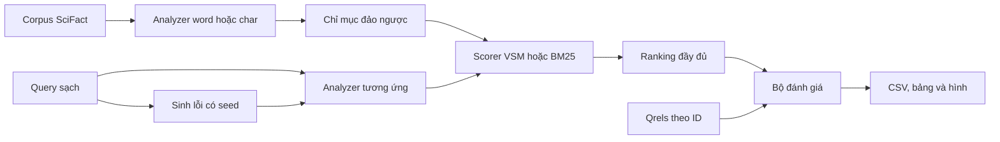
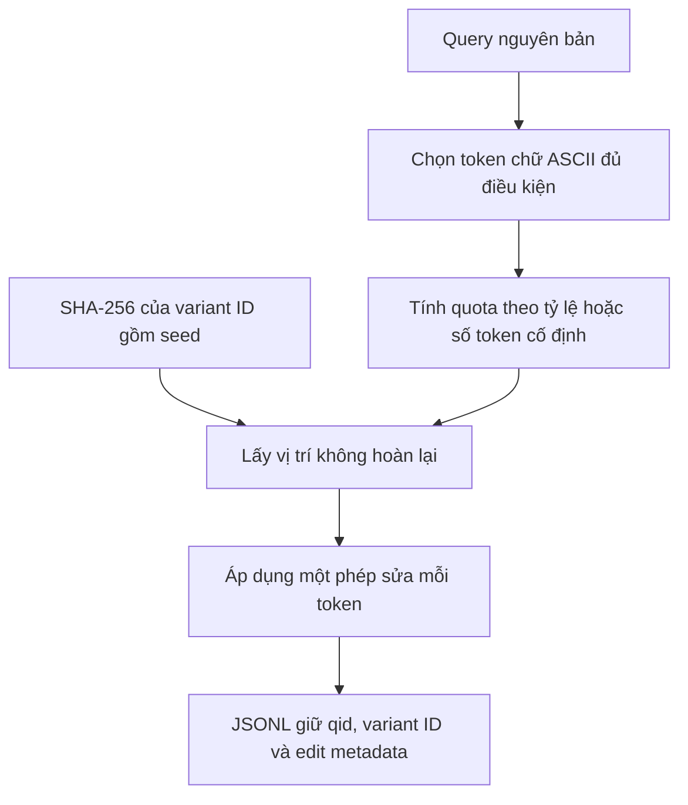
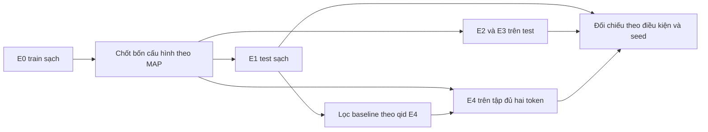
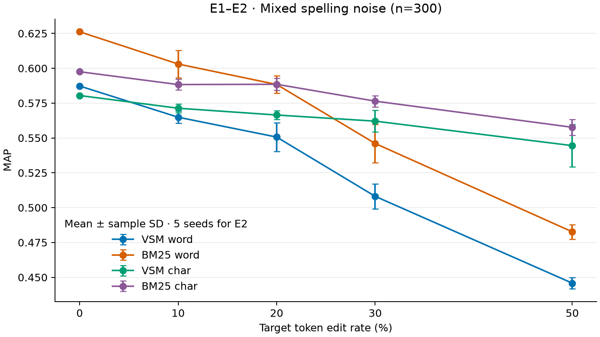
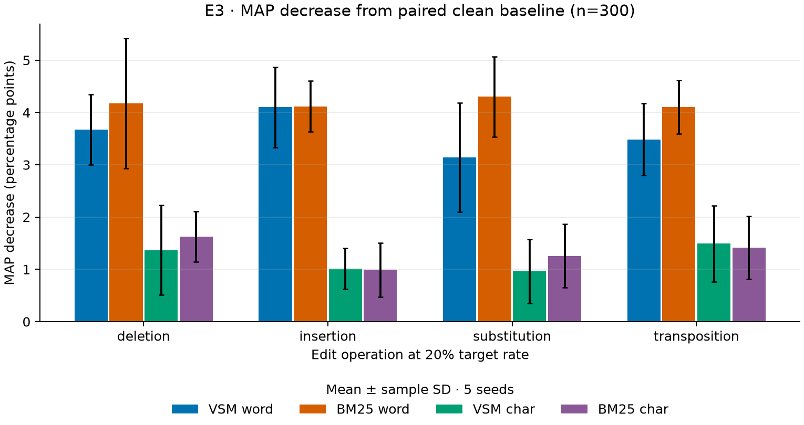
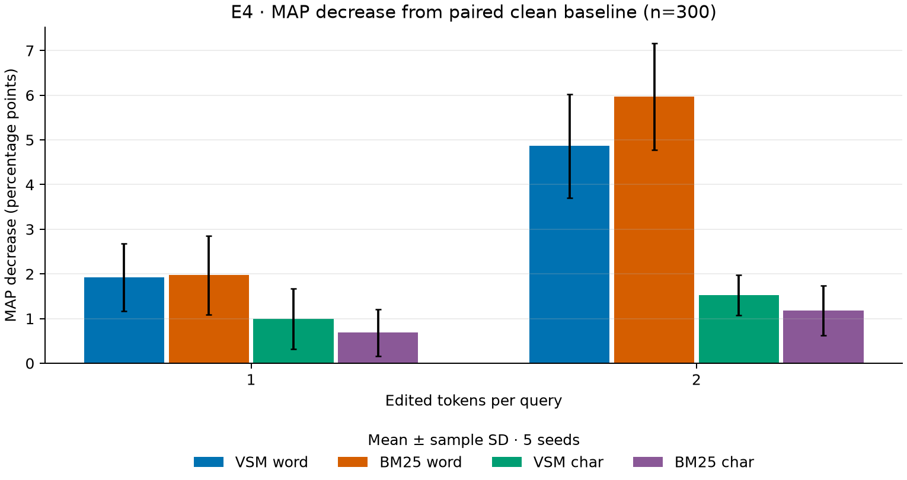
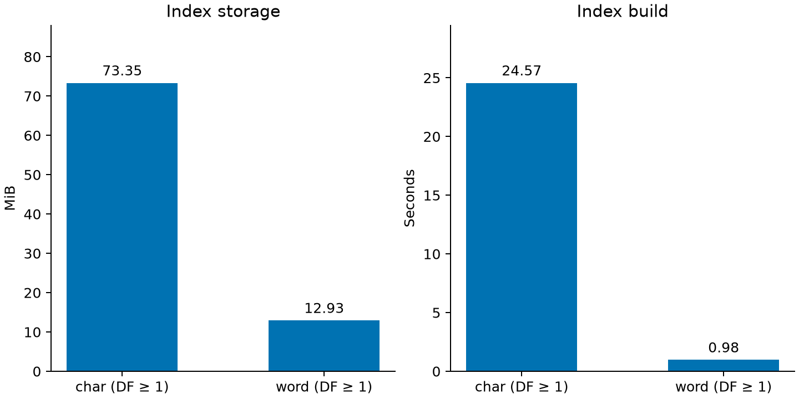
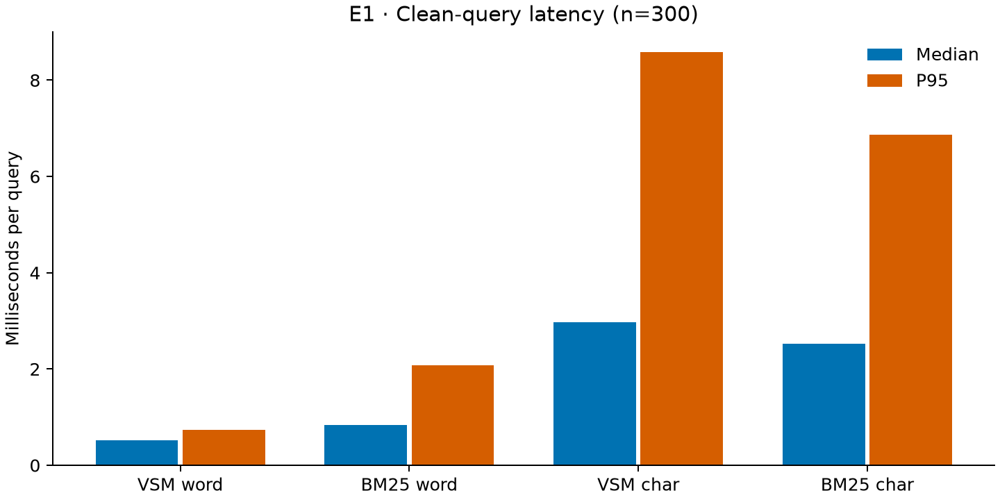

# Ảnh hưởng của lỗi chính tả đến truy xuất tài liệu trên BEIR SciFact

**Đồ án 1 · Tìm kiếm tài liệu · Môn Truy xuất thông tin**  
**Giảng viên:** TS. Nguyễn Trọng Chỉnh  
**Mã học phần chính thức:** [điền sau khi xác nhận]  
**Nhóm, lớp, họ tên và mã số sinh viên:** [nhóm bổ sung]  
**Ngày thực nghiệm:** 25/11/2026

## Tóm tắt

Đồ án đo ảnh hưởng của lỗi chính tả tổng hợp lên hai mô hình truy xuất từ vựng là Vector Space Model (VSM) và Okapi BM25. Mỗi mô hình dùng hai biểu diễn, word unigram và character n-gram độ dài 3–5. Nhóm xây chỉ mục đảo ngược cho 5.183 tài liệu BEIR SciFact, chọn cấu hình trên 809 truy vấn train và đánh giá 204 lượt trên 300 truy vấn test. BM25 word đạt MAP sạch cao nhất, 0,6262. Ở tỷ lệ lỗi mixed mục tiêu 50%, hai cấu hình word giảm 14,14–14,35 điểm phần trăm MAP, còn hai cấu hình char giảm 3,59–3,99 điểm. BM25 char đạt MAP 0,5577, cao nhất tại mức nhiễu này. Đổi lại, chỉ mục char có dung lượng khoảng 5,7 lần chỉ mục word. Các kết quả mô tả mức đánh đổi giữa chất lượng truy xuất sạch, độ bền trước lỗi và chi phí trên SciFact.

**Từ khóa:** truy xuất thông tin, lỗi chính tả truy vấn, TF-IDF, cosine, BM25, character n-gram, SciFact.

## Mục lục

1. [Giới thiệu](#1-giới-thiệu)
2. [Cơ sở lý thuyết và nghiên cứu liên quan](#2-cơ-sở-lý-thuyết-và-nghiên-cứu-liên-quan)
3. [Phân tích và chọn term](#3-phân-tích-và-chọn-term)
4. [Mô hình và công thức xếp hạng](#4-mô-hình-và-công-thức-xếp-hạng)
5. [Thiết kế và hiện thực hệ thống](#5-thiết-kế-và-hiện-thực-hệ-thống)
6. [Thiết kế thực nghiệm](#6-thiết-kế-thực-nghiệm)
7. [Kết quả và thảo luận](#7-kết-quả-và-thảo-luận)
8. [Kết luận](#8-kết-luận)
9. [Tài liệu tham khảo](#tài-liệu-tham-khảo)
10. [Phụ lục tái lập và phân công](#phụ-lục-tái-lập-và-phân-công)

## 1. Giới thiệu

Một lỗi gõ có thể biến từ khóa khoa học thành term ngoài từ vựng và làm tài liệu phù hợp tụt hạng. Ví dụ trong SciFact, truy vấn 536 có phép sửa `Hypocretin → Hypccretin`. BM25 word đẩy tài liệu có qrel dương từ hạng 1 xuống 31, trong khi BM25 char giữ hạng 1. Đây là một ca minh họa được phân tích chi tiết ở Chương 7. [Dữ liệu ca truy vấn](../results/p15-scifact-20261125/cases.csv)

Đầu vào là corpus cố định, tập truy vấn sạch và qrels theo ID. Đầu ra là danh sách tài liệu có điểm dương hữu hạn, xếp theo điểm giảm dần. Mỗi truy vấn nhiễu vẫn giữ ID gốc để đối chiếu với cùng qrels. Đồ án nghiên cứu truy xuất ở cấp tài liệu và sử dụng nhãn liên quan nhị phân.

Năm câu hỏi nghiên cứu lần lượt xét tác động của lỗi lên chất lượng (RQ1), loại lỗi gây suy giảm nhiều nhất (RQ2), ảnh hưởng của mức nhiễu (RQ3), độ bền của VSM và BM25 (RQ4), và lợi ích của character n-gram (RQ5). Phần mở rộng RQ6 về tự động sửa chính tả nằm ngoài phạm vi thực nghiệm E0–E4. Đóng góp của đồ án gồm chỉ mục đảo ngược dùng chung cho hai scorer, bộ sinh lỗi có thể tái lập, và pipeline đánh giá có ranking, metric và manifest cho từng lượt.

## 2. Cơ sở lý thuyết và nghiên cứu liên quan

Truy xuất thông tin tìm và xếp hạng tài liệu theo nhu cầu biểu đạt trong truy vấn. Chỉ mục đảo ngược ánh xạ term sang danh sách tài liệu chứa term đó. VSM xem tài liệu và truy vấn như hai vector có trọng số, rồi tính cosine. BM25 điều chỉnh trọng số theo độ hiếm của term, giảm lợi ích cận biên khi TF tăng và chuẩn hóa theo độ dài tài liệu. [Manning và cộng sự, 2008](https://doi.org/10.1017/CBO9780511809071) · [Robertson và Zaragoza, 2009](https://doi.org/10.1561/1500000019)

Nghiên cứu của Zhuang và Zuccon ghi nhận truy vấn có lỗi gõ làm giảm hiệu quả của mô hình truy xuất và xếp hạng dựa trên BERT trên MS MARCO. Kết quả đó đặt ra câu hỏi tương tự cho hai mô hình từ vựng trong đồ án. Biểu diễn n-gram ký tự có thể giữ những đoạn con quanh vị trí lỗi. Ví dụ `cancer` và `cancre` vẫn chia sẻ `can`, `anc` và `canc`, trong khi word unigram biểu diễn chúng bằng hai term khác nhau. [Zhuang và Zuccon, 2021](https://aclanthology.org/2021.emnlp-main.225/)

SciFact gốc hỗ trợ chọn evidence và xác minh nhận định khoa học. BEIR cung cấp biến thể dùng cho xếp hạng tài liệu theo qrels. Trong đồ án, một abstract có qrel dương được tính là liên quan bất kể nó ủng hộ hay bác bỏ nhận định. [Wadden và cộng sự, 2020](https://aclanthology.org/2020.emnlp-main.609/) · [Thakur và cộng sự, 2021](https://arxiv.org/abs/2104.08663)

## 3. Phân tích và chọn term

Corpus là title ghép với text, ngăn bằng một khoảng trắng. Pipeline chuẩn hóa Unicode NFKC, chuyển chữ thường, rồi tách token theo các dãy `[a-z0-9]+`. Giữ chữ số và stopword. Word dùng các token này làm term. Char sinh tất cả cửa sổ ký tự 3, 4 và 5 bên trong từng token. Token ngắn hơn 3 ký tự mang tiền tố `short:` để giữ thông tin. Ví dụ `DNA` cho `dna`, còn `5` cho `short:5` ở cấu hình char. Tài liệu và truy vấn dùng cùng analyzer.

Lượt phân tích đầu đếm TF trong từng tài liệu, cộng vào CF của term và tăng DF một lần cho mỗi tài liệu chứa term. Giữ term nếu `DF ≥ min_df` và `DF / N ≤ max_df_ratio`. Analyzer mặc định dùng `max_df_ratio=1.0`; E0 so sánh `min_df=1` và `min_df=2`. Lượt kế tiếp cập nhật postings, độ dài tài liệu và norm bằng các term được giữ. DF, CF và vocabulary chỉ dựa trên corpus. [Mã tiền xử lý](../src/preprocessing.py) · [Mã chọn term](../src/term_selection.py)

| Biểu diễn | Ứng viên | Term giữ lại | Tỷ lệ giữ term và occurrence | Postings | Độ dài index TB |
|---|---:|---:|---:|---:|---:|
| Word | 35.731 | 35.731 | 100% | 633.511 | 225,22 |
| Char 3–5 | 84.202 | 84.202 | 100% | 5.381.877 | 1.951,73 |

Tỷ lệ term bằng số term phân biệt được giữ chia cho số term ứng viên phân biệt. Tỷ lệ occurrence dùng CF tương ứng. Cả hai tỷ lệ đạt 100% vì E0 chọn `min_df=1`. Số term xuất hiện là 1.167.320 cho word và 10.115.817 cho char. Danh sách term đầy đủ nằm trong TSV của từng index, gồm term, DF, CF và trạng thái lọc. [Bảng từ vựng và chi phí](../results/p15-scifact-20261125/index_cost.csv)

## 4. Mô hình và công thức xếp hạng

Gọi $N$ là số tài liệu, $f_{t,d}$ là tần suất term $t$ trong tài liệu $d$, $df_t$ là số tài liệu chứa $t$, $L_d$ là số term được giữ trong $d$, và $\overline L$ là trung bình $L_d$ trên toàn corpus.

### VSM với TF-IDF và cosine

Với term có tần suất dương, đặt $w_{t,d}=(1+\ln f_{t,d})[1+\ln((N+1)/(df_t+1))]$. Trọng số bằng 0 khi term vắng mặt. Tính $w_{t,q}$ tương tự từ TF của truy vấn và cùng IDF của corpus sau khi bỏ term OOV.

$$
\mathrm{VSM}(d,q)=\frac{\sum_t w_{t,d}w_{t,q}}{\sqrt{\sum_t w_{t,d}^{2}}\sqrt{\sum_t w_{t,q}^{2}}}
$$

Norm tài liệu được tính trên toàn bộ vector từ khi xây index. Khi norm truy vấn bằng 0, ranking rỗng. [VSM scorer](../src/tfidf.py)

### Okapi BM25

$$
\mathrm{BM25}(d,q)=\sum_{t\in q\cap V}
\ln\left(1+\frac{N-df_t+0.5}{df_t+0.5}\right)
\frac{f_{t,d}(k_1+1)}{f_{t,d}+k_1(1-b+bL_d/\overline L)}
$$

$V$ là vocabulary của index. Phép tổng đi qua các term truy vấn phân biệt. $k_1$ điều khiển độ bão hòa của TF, còn $b$ điều khiển mức chuẩn hóa độ dài. Khi $\overline L=0$, ranking rỗng. [BM25 scorer](../src/bm25.py)

Ví dụ tính tay với hai tài liệu `alpha alpha beta` và `alpha`, dùng truy vấn `alpha`. VSM cho tài liệu thứ hai cosine 1, còn tài liệu thứ nhất nhận $(1+\ln 2)/\sqrt{(1+\ln 2)^2+(1+\ln(3/2))^2}$ vì còn trọng số của `beta`. Với BM25 mặc định $k_1=1{,}2$ và $b=0{,}75$, độ dài trung bình là 2. Điểm lần lượt là $\ln(1{,}2)\times 4{,}4/3{,}65$ và $\ln(1{,}2)\times 2{,}2/1{,}75$, cho thấy chuẩn hóa độ dài có thể đưa tài liệu ngắn lên trên dù TF thấp hơn.

## 5. Thiết kế và hiện thực hệ thống



*Hình 1. Luồng dữ liệu và xử lý truy vấn.*

Một posting list có dạng `term → {doc_id: tf}`. Ví dụ `alpha → {D1: 2, D2: 1}`. Index lưu DF, CF, độ dài và norm từng tài liệu, IDF của hai scorer, tiêu đề, snippet, cấu hình analyzer, schema và checksum corpus. Hai lượt xây dựng có chi phí xấp xỉ tuyến tính theo số occurrence term, chưa tính sắp xếp từ vựng và I/O. Truy xuất duyệt posting của các term khớp, cộng điểm, chuẩn hóa theo mô hình rồi sắp theo điểm giảm dần và doc ID dạng chuỗi tăng dần khi hòa điểm. Batch scorer dùng mảng NumPy cho posting thưa và bộ tích lũy theo tài liệu. [Mã index](../src/inverted_index.py) · [Batch scorer](../src/batch_scoring.py)



*Hình 2. Quy trình sinh lỗi.*

Token đủ điều kiện gồm ít nhất ba chữ ASCII. Các token chứa số hoặc gạch dưới được giữ nguyên. Transposition yêu cầu cặp chữ kề nhau khác nhau sau lowercase. Mixed chọn đều giữa các phép khả thi trên token đã chọn. Với tỷ lệ $r$ và $m$ token đủ điều kiện, chọn $\lfloor rm+0.5\rfloor$ token. Chế độ cố định ghi trạng thái thiếu token nếu không đạt số yêu cầu. JSONL lưu văn bản gốc, văn bản nhiễu, phép sửa, vị trí token/ký tự, seed, tỷ lệ thực tế và cờ term sửa có trong corpus. [Mã sinh lỗi](../src/noise_generator.py)

| Thành phần | Trách nhiệm kiểm chứng |
|---|---|
| `data_loader`, `dataset_stats` | Kiểm tra ID, qrels, split và thống kê dữ liệu |
| `preprocessing`, `term_selection`, `inverted_index` | Chuẩn hóa, từ vựng, posting, norm và thống kê index |
| `tfidf`, `bm25`, `batch_scoring` | Điểm ranking và đối chiếu hai backend |
| `noise_generator`, `evaluation` | Lỗi tái lập, MAP đầy đủ và metric ở cutoff |
| `experiments`, `experiment_runner`, `results_analysis` | Lịch chạy, khóa cấu hình, manifest, kết quả và biểu đồ |

Bộ kiểm thử kiểm tra công thức trên corpus nhỏ, lỗi tái lập, truy vấn OOV/rỗng, tie-break và việc khóa cấu hình E0 trước khi có qrels test. Đối chiếu với `ir-measures` 0.4.3 cho kết quả khớp 100 giá trị metric trên 20 ranking SciFact. Bộ test gần nhất có 30 test và 6 subtest đạt. [Nhật ký kiểm thử](../docs/PROGRESS.md) · [Kiểm thử tích hợp](../tests/test_integration.py)

## 6. Thiết kế thực nghiệm

Corpus và truy vấn lấy từ BeIR/scifact trên Hugging Face, qrels từ BeIR/scifact-qrels. Loader bảo toàn ID dạng chuỗi, kiểm tra dữ liệu rỗng, trùng ID, qrels tham chiếu hợp lệ và tách biệt ID train/test. Manifest ghi SHA-256 cho từng tệp. [Corpus và queries](https://huggingface.co/datasets/BeIR/scifact) · [Qrels](https://huggingface.co/datasets/BeIR/scifact-qrels) · [Manifest dữ liệu](../data/raw/scifact/dataset_manifest.json)

| Tập | Số bản ghi | Qrel dương | Độ dài min / trung vị / TB / max |
|---|---:|---:|---|
| Tài liệu | 5.183 | — | 38 / 213 / 225,22 / 1.575 |
| Truy vấn train | 809 | 919 | 3 / 12 / 12,83 / 41 |
| Truy vấn test | 300 | 339 | 4 / 12 / 13,06 / 29 |

Độ dài theo token ASCII sau NFKC và lowercase, trước chọn term. Tất cả qrels có nhãn 1. Test có trung bình 1,13 tài liệu qrel dương mỗi truy vấn. [Thống kê dữ liệu](../results/p15-scifact-20261125/dataset_stats.csv)

| Nhóm | Dữ liệu và điều kiện | Số lượt |
|---|---|---:|
| E0 | Train sạch, chọn cấu hình theo MAP cho M1–M4 | 20 |
| E1 | Test sạch | 4 |
| E2 | Mixed 10%, 20%, 30%, 50%, seed 42–46 | 80 |
| E3 | Deletion, insertion, substitution, transposition ở 20%, seed 42–46 | 80 |
| E4 | Mixed cố định 1 hoặc 2 token, seed 42–46 | 40 |
| E5 | Sửa chính tả, phần mở rộng | — |



*Hình 3. Giao thức E0–E4.*

E0 chọn độc lập cho từng mô hình và analyzer trên tập train sạch từ lưới $min\_df\in\{1,2\}$, BM25 $k_1\in\{1.2,1.5\}$ và $b\in\{0.75,0.5\}$. Khi hòa MAP, chọn ứng viên đứng đầu theo thứ tự lưới công bố. Khóa cấu hình trước khi chạy test. Tất cả mô hình cùng điều kiện dùng bản nhiễu chung và cùng qrels. E4 dùng một tập truy vấn đủ ít nhất hai token cho cả hai mức sửa, rồi lấy baseline E1 trên đúng tập này. Trong SciFact, tập E4 có đủ cả 300 truy vấn. [Cấu hình](../configs/default.yaml) · [Kết quả E0](../results/p15-scifact-20261125/tuning.csv)

Gọi rel(i) là chỉ báo tài liệu ở hạng $i$ có qrel dương và $R_q$ là tập tài liệu qrel dương của $q$. Precision@k dùng mẫu số $k$ kể cả ranking ngắn. Recall@k dùng mẫu số $|R_q|$. AP tính trên toàn bộ ranking có điểm dương hữu hạn.

$$
P@k=\frac{\sum_{i\le k}\mathrm{rel}(i)}{k},\quad
\mathrm{Recall}@k=\frac{\sum_{i\le k}\mathrm{rel}(i)}{|R_q|},\quad
AP_q=\frac{\sum_i P@i\,\mathrm{rel}(i)}{|R_q|},\quad
MAP=\frac{\sum_q AP_q}{|Q|}
$$

$$
DCG@k=\sum_{i=1}^k \frac{\mathrm{rel}(i)}{\log_2(i+1)},\qquad nDCG@k=\frac{DCG@k}{IDCG@k}
$$

$IDCG@k$ đặt các tài liệu qrel dương lên đầu theo số lượng dương tối đa trong $k$ vị trí. Tài liệu chưa có qrel được tính là không liên quan khi chấm điểm. Truy vấn có qrel dương nhưng ranking rỗng nhận điểm 0. Truy vấn thiếu qrel dương được ghi nhận rồi loại khỏi các trung bình. Mức giảm tuyệt đối bằng MAP baseline sạch trừ MAP nhiễu. Mức giảm tương đối chia tiếp cho baseline sạch và nhân 100. Báo cáo độ lệch chuẩn mẫu qua 5 seed. [Bộ đánh giá](../src/evaluation.py)

Môi trường chạy là Windows 11, Python 3.12.10 và NumPy 2.5.5 với một luồng theo manifest. Latency truy vấn đo trong bước scoring và xếp thứ tự, không gồm đọc index hoặc ghi ranking. P95 dùng hạng phân vị $\lceil 0.95n\rceil$. [Manifest một lượt E1](../data/processed/p14-scifact-20261125/E1-E4/manifests/E1-M1-clean.json)

## 7. Kết quả và thảo luận

### 7.1 Chọn tham số và baseline sạch

| Model | Scorer | Analyzer | min_df | k1 | b | MAP train |
| --- | --- | --- | --- | --- | --- | --- |
| M1 | VSM | word | 1 | ? | ? | 0,6065 |
| M2 | BM25 | word | 1 | 1.5 | 0.75 | 0,6326 |
| M3 | VSM | char | 1 | ? | ? | 0,5842 |
| M4 | BM25 | char | 1 | 1.2 | 0.5 | 0,6044 |

| Model | MAP | P@5 | P@10 | Recall@10 | nDCG@10 | T? l? r?ng |
| --- | --- | --- | --- | --- | --- | --- |
| M1 | 0,5873 | 0,1627 | 0,0860 | 0,7785 | 0,6329 | 0,0000 |
| M2 | 0,6262 | 0,1560 | 0,0870 | 0,7849 | 0,6645 | 0,0000 |
| M3 | 0,5804 | 0,1587 | 0,0880 | 0,7860 | 0,6301 | 0,0000 |
| M4 | 0,5975 | 0,1473 | 0,0827 | 0,7391 | 0,6297 | 0,0000 |

BM25 word có MAP và nDCG@10 cao nhất trên truy vấn sạch. VSM char có Recall@10 cao nhất. Đây là baseline để tính độ giảm cho từng cấu hình. [Kết quả E0](../results/p15-scifact-20261125/tuning.csv) · [Baseline E1](../results/p15-scifact-20261125/baseline.csv)

### 7.2 Tỷ lệ, loại và số lỗi cố định

Trong các bảng dưới, mỗi ô ghi **MAP trung bình ± độ lệch chuẩn mẫu / mức giảm tuyệt đối (điểm phần trăm) / mức giảm tương đối (%)**. Mỗi mức nhiễu dùng 5 seed. Dấu âm biểu thị trường hợp MAP tăng.

**E2**

T? l? token th?c s?a trung b?nh qua 5 seed l? 11,02%, 19,73%, 30,39%, 52,44% theo th? t? b?n m?c m?c ti?u.

| T? l? m?c ti?u | M1 | M2 | M3 | M4 |
| --- | --- | --- | --- | --- |
| 10% | 0,5649 ? 0,0044 / 2,24 / 3,81 | 0,6031 ? 0,0098 / 2,31 / 3,69 | 0,5713 ? 0,0032 / 0,91 / 1,57 | 0,5883 ? 0,0038 / 0,92 / 1,54 |
| 20% | 0,5506 ? 0,0104 / 3,66 / 6,24 | 0,5884 ? 0,0063 / 3,78 / 6,04 | 0,5665 ? 0,0032 / 1,40 / 2,41 | 0,5885 ? 0,0044 / 0,90 / 1,51 |
| 30% | 0,5081 ? 0,0089 / 7,92 / 13,48 | 0,5460 ? 0,0138 / 8,02 / 12,80 | 0,5621 ? 0,0077 / 1,84 / 3,17 | 0,5764 ? 0,0041 / 2,11 / 3,53 |
| 50% | 0,4458 ? 0,0041 / 14,14 / 24,09 | 0,4827 ? 0,0053 / 14,35 / 22,92 | 0,5445 ? 0,0153 / 3,59 / 6,19 | 0,5577 ? 0,0055 / 3,99 / 6,67 |



Ở E2, VSM word và BM25 word giảm khoảng 14 điểm phần trăm MAP ở mức 50%, trong khi hai cấu hình char giảm dưới 4 điểm. BM25 char có MAP cao nhất ở 30% và 50%. Từ 10% đến 20%, MAP trung bình của BM25 char gần như đi ngang. Ở E4, cả bốn cấu hình có mức giảm lớn hơn khi sửa hai token so với một. [Bảng tổng hợp](../results/p15-scifact-20261125/aggregate.csv)

**E3**

| Lo?i l?i | M1 | M2 | M3 | M4 |
| --- | --- | --- | --- | --- |
| deletion | 0,5505 ? 0,0067 / 3,67 / 6,25 | 0,5844 ? 0,0125 / 4,18 / 6,67 | 0,5667 ? 0,0085 / 1,37 / 2,36 | 0,5813 ? 0,0048 / 1,62 / 2,72 |
| insertion | 0,5463 ? 0,0077 / 4,10 / 6,98 | 0,5850 ? 0,0049 / 4,12 / 6,58 | 0,5703 ? 0,0039 / 1,01 / 1,75 | 0,5876 ? 0,0052 / 0,99 / 1,65 |
| substitution | 0,5559 ? 0,0105 / 3,14 / 5,34 | 0,5832 ? 0,0077 / 4,30 / 6,87 | 0,5708 ? 0,0062 / 0,96 / 1,66 | 0,5850 ? 0,0061 / 1,25 / 2,10 |
| transposition | 0,5524 ? 0,0069 / 3,49 / 5,93 | 0,5851 ? 0,0051 / 4,10 / 6,55 | 0,5655 ? 0,0073 / 1,49 / 2,57 | 0,5834 ? 0,0060 / 1,42 / 2,37 |



Loại lỗi có mức giảm trung bình lớn nhất ở E3 phụ thuộc cấu hình. Insertion đứng đầu với M1 (4,10 điểm phần trăm), substitution với M2 (4,30), transposition với M3 (1,49) và deletion với M4 (1,62). Độ lệch chuẩn giữa các seed chồng lấn ở nhiều điều kiện. [Bảng tổng hợp](../results/p15-scifact-20261125/aggregate.csv)

**E4**

| S? token s?a | M1 | M2 | M3 | M4 |
| --- | --- | --- | --- | --- |
| 1 | 0,5681 ? 0,0076 / 1,92 / 3,27 | 0,6065 ? 0,0089 / 1,97 / 3,15 | 0,5705 ? 0,0067 / 1,00 / 1,72 | 0,5907 ? 0,0053 / 0,68 / 1,14 |
| 2 | 0,5386 ? 0,0116 / 4,86 / 8,28 | 0,5665 ? 0,0120 / 5,97 / 9,54 | 0,5652 ? 0,0045 / 1,53 / 2,63 | 0,5858 ? 0,0056 / 1,18 / 1,97 |



### 7.3 Truy vấn đại diện và cơ chế khả dĩ

Giữ cố định điều kiện mixed 20%, seed 42. Xếp các truy vấn theo chênh AP nhiễu trừ AP sạch của BM25 word. Chọn ba truy vấn giảm mạnh nhất và ba truy vấn có mức tăng lớn nhất trong nhóm ổn định hoặc cải thiện. ID truy vấn xử lý hòa. Với mỗi truy vấn, kèm vị trí lỗi, danh sách term mất/giữ, OOV, top 5 và hạng tài liệu qrel dương. [Bảng ca phân tích](../results/p15-scifact-20261125/cases.csv) · [Chi tiết ca phân tích](../results/p15-scifact-20261125/cases.json)

| QID | Ph?p s?a | Qrel d??ng | AP BM25 word | AP BM25 char |
| --- | --- | --- | --- | --- |
| 536 | Hypocretin ? Hypccretin | 16056514 | 1,0000 ? 0,0323 | 1,0000 ? 1,0000 |
| 237 | defect ? dafect, sporulation ? sporulatmion | 4942718 | 1,0000 ? 0,0909 | 1,0000 ? 1,0000 |
| 692 | increased ? inceased, red ? led | 24088502 | 1,0000 ? 0,1667 | 1,0000 ? 1,0000 |
| 54 | activated ? cativated, kinase ? kiqase | 49556906 | 0,1111 ? 1,0000 | 0,0769 ? 0,1111 |
| 1266 | The ? Hte, association ? acssociation, strongest ? srongest, for ? fmr | 37480103 | 0,3333 ? 1,0000 | 0,3333 ? 0,5000 |
| 127 | interaction ? intraction | 21598000 | 0,5000 ? 1,0000 | 0,0435 ? 0,0333 |

Trong ba ca 536, 237 và 692, BM25 char giữ tài liệu qrel dương ở hạng 1. Ở 692, phép sửa `red → led` tạo một từ có trong corpus, vì vậy phép sửa có thể thêm khớp với tài liệu qua term mới. Ở 54, mất `activated` và `kinase` đi kèm với việc tài liệu qrel lên hạng 1 với BM25 word. Đây có thể là hệ quả của thay đổi tương quan điểm với các tài liệu cạnh tranh. Ở 127, BM25 char tụt từ hạng 23 xuống 30 cho tài liệu qrel, dù BM25 word cải thiện từ 2 lên 1. Tài liệu 293661 ở hạng 1 của BM25 char nhiễu chia sẻ các n-gram như `arg`, `argi`, `argin` nhưng thiếu qrel dương. Khớp cục bộ có thể góp phần đẩy tài liệu đó lên cao. [Chi tiết ca phân tích](../results/p15-scifact-20261125/cases.json)

### 7.4 Chi phí và trả lời câu hỏi nghiên cứu

| Biểu diễn | Dung lượng index | Thời gian xây index | P50/P95 VSM | P50/P95 BM25 |
|---|---:|---:|---:|---:|
| Word | 12,93 MiB | 0,98 giây | 0,52 / 0,73 ms | 0,84 / 2,07 ms |
| Char | 73,35 MiB | 24,57 giây | 2,98 / 8,58 ms | 2,53 / 6,87 ms |





1. **RQ1.** Tất cả điều kiện mixed có MAP trung bình thấp hơn baseline của chính cấu hình.
2. **RQ2.** Loại lỗi có mức giảm lớn nhất phụ thuộc mô hình và biểu diễn. Thứ tự trên dựa vào trung bình của 5 seed.
3. **RQ3.** Mức giảm nhìn chung tăng theo tỷ lệ mục tiêu. E4 cho mức giảm lớn hơn khi sửa hai token ở cả bốn cấu hình.
4. **RQ4.** BM25 dẫn đầu về MAP tuyệt đối trong từng biểu diễn ở E1 và E2. So theo mức giảm từ baseline riêng, thứ tự VSM và BM25 phụ thuộc biểu diễn và điều kiện.
5. **RQ5.** Char giảm ít MAP hơn word trong tất cả các mức mixed, ở cả VSM và BM25. Lợi ích đi kèm với index lớn hơn và latency cao hơn.

Cấu hình BM25 word và char có tham số tối ưu khác nhau. Kết quả BM25 vì vậy phản ánh hiệu năng của hai cấu hình được chọn trên train. Các độ lệch chuẩn mô tả độ biến thiên qua seed và chưa được dùng để kiểm định ý nghĩa thống kê. Qrels thưa, lĩnh vực khoa học chuyên biệt và phép sinh lỗi tổng hợp giới hạn khả năng khái quát sang tập tài liệu khác hoặc lỗi gõ tự nhiên. [Phân tích P15](../results/p15-scifact-20261125/analysis.md)

## 8. Kết luận

Trên truy vấn sạch của SciFact, BM25 word đạt MAP cao nhất. Khi lỗi mixed tăng tới 50%, BM25 char đạt MAP 0,5577 so với 0,4827 của BM25 word. Character n-gram giữ nhiều khớp cục bộ qua lỗi gõ, với chi phí kích thước index và thời gian truy vấn tăng. Các ca đối lập cho thấy lợi ích phụ thuộc term bị sửa và các tài liệu cạnh tranh. Hướng tiếp theo là đối chiếu trên nhiều corpus và lỗi gõ tự nhiên, thử sửa lỗi theo từ điển và đánh giá chênh lệch MAP bằng kiểm định ghép cặp theo truy vấn.

## Tài liệu tham khảo

1. Nguyễn Trọng Chỉnh. *Truy xuất thông tin – Đề tài đồ án 1 – Tìm tài liệu* và đề cương môn học cập nhật 07/2024. [Slide môn học](../docs/Slide-13-01.pdf) · [Đề cương](../docs/CS419-DeCuong.docx.pdf)
2. Manning, C. D., Raghavan, P., và Schütze, H. (2008). *Introduction to Information Retrieval*. Cambridge University Press. [DOI](https://doi.org/10.1017/CBO9780511809071)
3. Robertson, S., và Zaragoza, H. (2009). *The Probabilistic Relevance Framework: BM25 and Beyond*. Foundations and Trends in Information Retrieval. [DOI](https://doi.org/10.1561/1500000019)
4. Thakur, N., Reimers, N., Rücklé, A., Srivastava, A., và Gurevych, I. (2021). *BEIR: A Heterogenous Benchmark for Zero-shot Evaluation of Information Retrieval Models*. NeurIPS Datasets and Benchmarks. [Bài báo](https://arxiv.org/abs/2104.08663)
5. Wadden, D., Lin, S., Lo, K., Wang, L. L., van Zuylen, M., Cohan, A., và Hajishirzi, H. (2020). *Fact or Fiction: Verifying Scientific Claims*. EMNLP. [ACL Anthology](https://aclanthology.org/2020.emnlp-main.609/)
6. Zhuang, S., và Zuccon, G. (2021). *Dealing with Typos for BERT-based Passage Retrieval and Ranking*. EMNLP. [ACL Anthology](https://aclanthology.org/2021.emnlp-main.225/)

## Phụ lục tái lập và phân công

Chạy từ thư mục gốc dự án. Sau khi đặt BEIR SciFact trong `data/raw/scifact/`, kiểm tra bộ test trước, rồi dùng các thư mục đầu ra mới cho E0, E1–E4 và tổng hợp.

```powershell
py -3.12 -m venv .venv
.\.venv\Scripts\python.exe -m pip install -r requirements.txt
.\.venv\Scripts\python.exe -m pytest -q
.\.venv\Scripts\python.exe -m src.cli tune --split train --output data/processed/reproduction/E0
.\.venv\Scripts\python.exe -m src.cli experiment --split test --selected-config data/processed/reproduction/E0/selected_config.yaml --output data/processed/reproduction/E1-E4
.\.venv\Scripts\python.exe -m src.results_analysis --run data/processed/reproduction --output results/p15-reproduction
```

Thư mục `data/processed/p14-scifact-20261125/E0/indexes/` chứa TSV ứng viên và term giữ lại, stats và index cho từng analyzer/ngưỡng DF. Thư mục `E1-E4/` cùng cấp chứa ranking, noise JSONL, per-query CSV và manifest. Lần chạy đã lưu khoảng 18,55 GB ranking. Dùng các CSV công bố để đọc kết quả tổng hợp. [Kết quả từng lượt](../results/p14-scifact-20261125/summary.csv) · [Bằng chứng xác minh](../data/processed/p14-scifact-20261125/verification.json)

**Phân công nhóm:** [điền tên, phần đảm nhiệm và đóng góp thực tế của từng thành viên]. Các nhóm công việc gồm dữ liệu và lập chỉ mục, truy xuất và sinh lỗi, thực nghiệm và phân tích, biên tập báo cáo.
